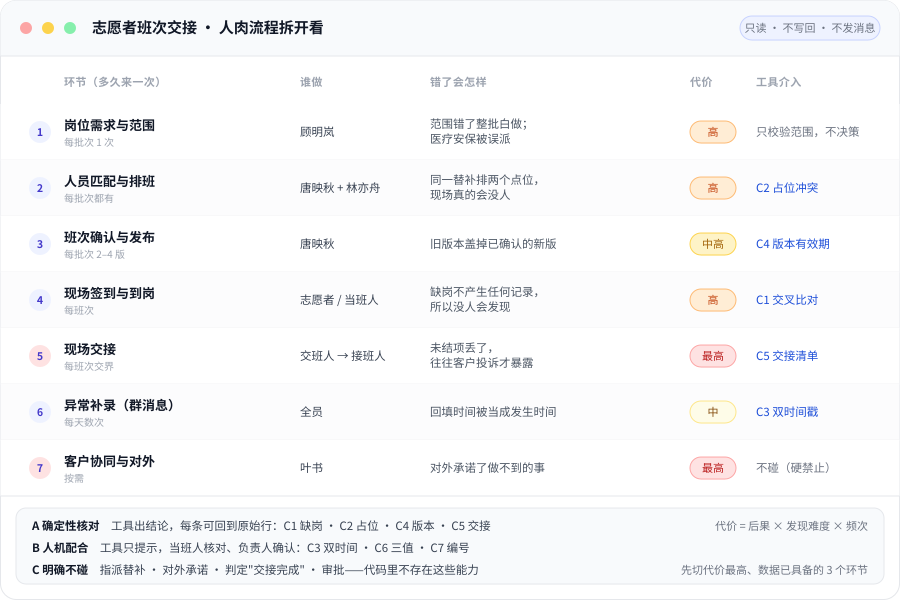

# volunteer-handover

> 志愿者班次交接的**只读核对**工具：把"两边对不上"的事实定位到具体行，交给人确认。
> 它不出结论、不改数据、不发消息、不指派岗位。

面向赛事现场的多点协作：排班表、签到记录、交接记录分别躺在三个工具里，没有统一编号，
群里说起某个班次时谁也说不清是哪一行。这个工具只做一件事——**用确定性规则把对不上的
地方找出来，附上来源位置，交给人判断**。

---

## 为什么这么小

访谈里最常被重复的一句话是"必须先比群消息快"。任何需要人多点两下的设计都会立刻被绕过去。
所以这里刻意砍到三件产物：

| 产物 | 给谁 | 解决什么 |
|---|---|---|
| 一页缺项清单 `out/items.md` | 现场协调员 | 今天哪些对不上、在哪一行、建议怎么做 |
| 交接责任清单 `out/handover.md` | 流程协调员 | 谁交给谁、依据哪一版、哪些未结项 |
| 快照 + 审计 `out/snapshots.csv` `out/audit.csv` | 质量负责人 | 当时读的是哪一份、谁查过、用的哪版 |
| 复核指标 `out/metrics.md` | 业务负责人 | 误报率、确认率、复核滞后——**没有它就说不清试点有没有用** |

六个需求点里，真正需要写代码的只有两个（清单），另外两个是数据前提（双时间戳、关联编号），
剩下两个是流程（人工队列、暂停开关），不该用代码解决。

## 一眼看清：人的流程里，哪一步最贵

一条班次信息在现场要经过 7 次人手。工具在 6 个环节出提示，但**一个环节都不接手**；
最贵的两件事（交接算不算完成、能不能对外承诺）它连建议都不给——那两件事一旦由系统发起，
责任就从人身上滑走了。

<p align="center">
  
</p>

按"错了多久才有人发现"排序，结果有点反直觉：**代价最高的两个环节，一个是"没有事件"（缺岗），
一个是"事件不完整"（未结项），都不是"字段填错"。** 所以这里的重点不是校验格式，
而是把"本该有记录却没有"暴露出来。

| 代价 | 环节 | 为什么这么算 | 处置 |
|---|---|---|---|
| 最高 | 现场交接 | 未结项丢了，往往到客户投诉才暴露 | 清单给人，人确认（C5） |
| 最高 | 客户协同与对外 | 承诺了做不到的事，收不回来 | **不碰**，硬禁止 |
| 高 | 现场签到 | 缺岗不产生记录，所以永远不会被自己发现 | 确定性比对（C1） |
| 高 | 人员匹配 | 同一替补排两个点位，现场真的会没人 | 确定性比对（C2） |
| 中高 | 确认与发布 | 旧版本盖掉新版本，几天后才发现 | 版本双条件（C4） |

完整的 7 步拆解、代价三因子、以及"看起来该自动化但不该做"的三个想法，见
[docs/workflow.md](docs/workflow.md)。

## 30 秒跑起来

只依赖 Python 3.9+ 标准库，没有第三方包。

```bash
# 1) 跑一遍样本数据（虚构数据，见 data/）
PYTHONPATH=src python3 -m volunteer_handover.main

# 2) 带上人工复核回填，看误报率/确认率怎么算出来
PYTHONPATH=src python3 -m volunteer_handover.main \
    --review data/review.csv --run-at 2026-10-03T17:00:00

# 3) 桌面推演：一条缺项怎么从原始行走到人工确认
PYTHONPATH=src python3 examples/demo.py

# 4) 跑测试（128 个，无需 pytest）
python3 -m unittest discover -s tests -t tests
```

输出长这样：

```
批次 B-2026-10-03-A · 只读核对完成 · 20 条待复核
  交接责任清单：3 条
  范围外已排除：2 个班次（医疗/安保不进入试点）
  按类型：未结项归属缺失 5、缺岗未登记 3、交接确认链缺失 2、版本断链或过期 2、…

序号 校验 类型               对象  业务发生            系统接收            位置
1    C1   排班表与现场不一致 S004  2026-10-03T10:03:00 2026-10-03T10:04:00 shifts.csv#L5 + checkins.csv#L4
2    C1   缺岗未登记         S005  2026-10-03T10:00:00 2026-10-03T09:50:00 shifts.csv#L6
5    C2   疑似重复占位       Z0007 2026-10-03T09:00:00 2026-10-03T08:35:00 shifts.csv#L5 + shifts.csv#L6
```

每条都带 `文件#L行号`，能一跳回到原始行。这是"可追溯"的全部含义：不是一句描述，是一个坐标。

## 试点能不能收尾，看两个数

清单发出去不算完成，得有人核、结论回得来，W4 复盘才有依据。

```bash
# 误报率 / 确认率 / 复核滞后（读已落盘的 CSV，不重跑核对）
python3 scripts/metrics.py --items out/items.csv --review data/review.csv \
    --run-at 2026-10-03T17:00:00

# 金标比对：召回率 + "G1 能不能关"
python3 scripts/score.py --items out/items.csv --gold data/gold_overlap.csv
```

两个口径上要守住的地方：

- **误报率的分母是"已复核"**，不是"全部条目"。拿没核过的当误报，数字会好看，但是假的。
- **召回率的分母是金标里的真重叠对数**。"发现全部重叠"没有分母就永远无法判定真假，
  所以 `data/gold_overlap.csv` 必须先有人标（W3 回放 50 次调班）。

复核回填表格式与硬规则见 [docs/api.md §2.1](docs/api.md)。没有复核人、没有复核时间的行不生效——
没人负责的"已确认"等于没确认。

## 在 VS Code 里跑

仓库带好了 `.vscode/` 配置，打开文件夹就能用，不需要改任何设置。

1. **打开**：`File > Open Folder…` 选这个目录。
2. **装扩展**：右下角弹「此工作区有推荐扩展」→ 点安装。只有 `ms-python.python` 一个，
   调试器和 Pylance 会跟着装上。项目零第三方依赖，**不用建虚拟环境、不用 pip install**。
3. **跑起来**：`Cmd+Shift+B` 跑默认构建任务（语法 + 128 个测试 + 推演 + 端到端产物），
   终端出现「构建通过」就说明环境齐了。
4. **看清单**：`Cmd+Shift+P` → `Tasks: Run Task` → 「运行核对并打开清单」。

「运行和调试」面板预置了六个配置：

| 配置 | 作用 |
|---|---|
| ① 运行核对（当前批次） | 跑主程序，产物写 `out/` |
| ② 桌面推演（W0） | 走一遍「Z0007 两个点位」的完整故事 |
| ③ 演示：输入读不到会怎样 | 看 C8 怎么标记而不是补值 |
| ④ 调试全部单元测试 | 128 个测试，可打断点 |
| ⑤ 调试当前打开的测试文件 | 调试 `tests/test_*.py` |
| ⑥ 调试当前打开的文件 | 通用 |

测试也可以走左侧烧瓶图标（Testing），已配好 `python.testing.unittestEnabled`，能逐个点开跑。

常用任务（`Tasks: Run Task`）：构建自检 / 跑全部单元测试 / 边界守卫 / 门禁检查
（门禁没全关会拒绝出包，退出码 3 属预期）。

> 为什么不起虚拟环境：这个工具只用标准库，多一个 `.venv` 只会让「换台机器就跑不起来」。
> 唯一要求是 Python 3.9+，macOS 自带的就够。

## 边界写在代码里，不写在提示词里

| 不做 | 代码位置 |
|---|---|
| 写回业务系统 | `core/boundary.py` 的 `FORBIDDEN_CAPABILITIES` |
| 发外部消息 / 通知 | 同上；`tests/test_boundary.py` 断言引擎不引入任何网络库 |
| 自动指派（尤其医疗、安保） | 同上；`config` 里 `auto_assign_categories` 必须为空 |
| 为缺失值补默认值 | `core/fields.py` 三值逻辑：缺失 ≠ 未确认 |
| 预设"迟到多久算超时" | `config` 的 `backfill_threshold_minutes: null`，事实未核实就不填 |
| 判定"交接是否完成" | `core/handover.py` 只输出信号，不输出 `is_complete` |
| 缺列时"尽力而为" | `core/schema.py`：缺必需列直接 blocked（本次不出结论），缺可选列跳过并告警 |
| 替人做复核结论 | `core/review.py`：状态只认 已确认/已驳回/转人工队列，且必须有复核人 |

## 目录

```
volunteer-handover/
├── src/volunteer_handover/
│   ├── main.py              # CLI 入口（退出码 0 正常 / 2 阻断）
│   ├── core/
│   │   ├── boundary.py      # 能力禁用清单
│   │   ├── fields.py        # 字段字典 + 三值逻辑
│   │   ├── times.py         # 双时间戳 / 时间窗 / 重叠
│   │   ├── ids.py           # 关联编号（候选规则，待业务方拍板）
│   │   ├── loader.py        # 只读加载，失败即标记
│   │   ├── checks.py        # C1–C9 九条确定性校验
│   │   ├── items.py         # 产物 A：一页缺项清单
│   │   ├── handover.py      # 产物 B：交接责任清单
│   │   ├── trace.py         # 快照 + 来源位置
│   │   ├── schema.py        # 表头契约：缺必需列就阻断
│   │   ├── review.py        # 复核回填（没人负责的结论不生效）
│   │   ├── metrics.py       # 误报率 / 确认率 / 复核滞后
│   │   ├── gold.py          # 金标比对：召回率与 G1 判定
│   │   └── engine.py        # 编排
│   └── utils/               # 配置解析、CSV、审计日志
├── docs/
│   ├── workflow.md          # 人的流程摊开 + 出错代价排序 + 切改三档
│   ├── flow.svg             # 上面那张流程图的源文件（可改字改色）
│   ├── design.md            # 为什么这么切、九条校验的设计理由、已知取舍
│   ├── api.md               # 数据契约（CSV 列）+ 模块 API + CLI
│   └── gates.md             # 三门禁：判定方法 / 值守与叫停 / "完成"的定义
├── data/                    # 虚构样本 + review.csv（复核回填示例）+ gold_overlap.csv（金标示例）
├── examples/demo.py         # W0 桌面推演
├── tests/                   # 128 个单元测试
├── scripts/
│   ├── build.sh             # 本地自检：语法、测试、demo、端到端产物
│   ├── deploy.sh            # 发布前检查：门禁没关就拒绝出包（退出码 3）
│   ├── metrics.py           # 从落盘 CSV 复算复核指标
│   ├── score.py             # 金标比对（G1 关不掉时退出码 3）
│   ├── check_boundary.py    # 配置里不得出现写回/外发/指派
│   └── check_syntax.py      # 语法检查（不写字节码）
├── config/default.yaml      # 非机密默认参数
├── .vscode/                 # 打开即用：解释器、PYTHONPATH、六个调试配置、构建任务
└── .github/                 # CI + issue/PR 模板
```

## 现在的状态

**只能跑桌面推演，不能进现场。** 三门禁尚未关闭，明细与签字栏见 [docs/gates.md](docs/gates.md)：

- [ ] **G1** "发现全部重叠"的判定方法与判定人（傅景 + 秦芮）
- [ ] **G2** 人工队列值守人、响应时限、暂停批准人（傅景 + 唐映秋 + 林亦舟）
- [ ] **G3** "完成"是否包含交接确认（顾明岚 + 唐映秋，叶书确认客户侧）

`scripts/deploy.sh` 会读那份文件，只要还有一个未勾就拒绝出包（退出码 3）。
这三个不关，工具跑得再顺也只是演练。原因很直接：清单里少一条没人知道，多一条会让人
多花 5 分钟核对，而"必须比群消息快"是唯一不能破的约束。

## 路线图

| 阶段 | 做什么 | 产出 |
|---|---|---|
| W0（当前） | 桌面推演 + 关三门禁 | 本仓库 + 门禁结论 |
| W1 | 数据地基薄版：双时间戳 + 关联编号 + 快照 | 单批次只读导出能跑通 |
| W2 | 清单进现场，只开 4 类异常；每天回填 review.csv | 一页清单 + 核对工时基线 |
| W3 | 回放 50 次调班做金标比对（`scripts/score.py`） | 召回率 / 误报率 |
| W4 | 复盘决策门 | 扩范围 / 收窄 / 停止 |

验收指标先测基线，不预设阈值；其中两项是硬门：确认完整率必须 100%，
**必要复核保留率**必须 100%（防止靠砍掉必要核对来刷效率）。

## 许可

MIT，见 [LICENSE](LICENSE)。样本数据全部为虚构演练数据。
